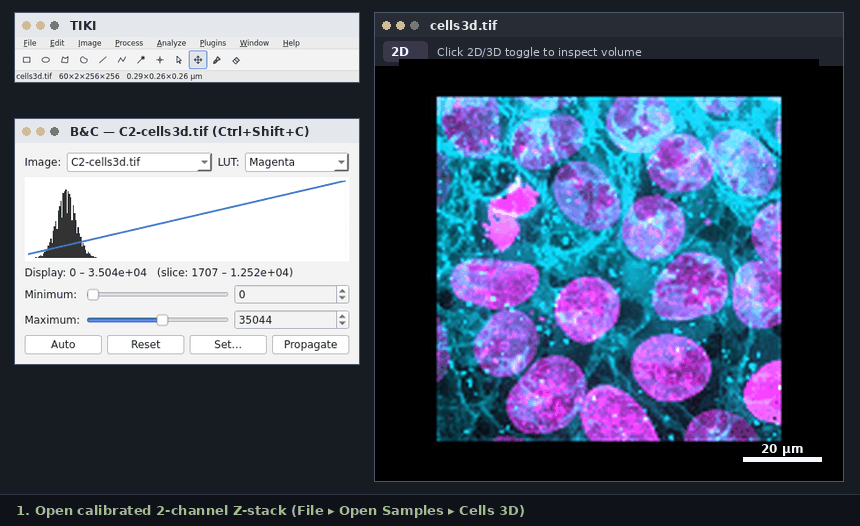
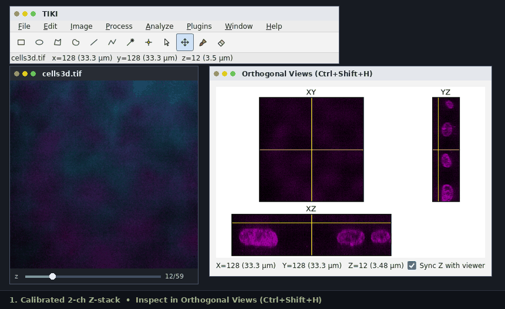
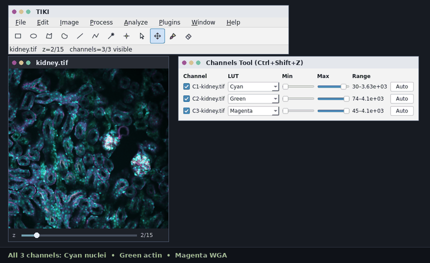

<p align="center">
  
</p>

<p align="center">
  <strong>An ImageJ-style toolbar for napari.</strong><br>
  Familiar tools and workflows, backed by Python image processing.
</p>

<p align="center">
  <a href="https://github.com/Peter-Hogg/tiki/releases"></a>
  <a href="https://github.com/Peter-Hogg/tiki/actions/workflows/tests.yml"></a>
  <a href="https://peter-hogg.github.io/tiki/"></a>
  <a href="LICENSE"></a>
</p>

<p align="center">
  <br>
  <sub><b>3D Volume View:</b> one click switches any calibrated Z-stack to interactive 3D rendering while adjusting <b>Brightness/Contrast</b> (<code>Ctrl+Shift+C</code>) live.</sub>
</p>

<p align="center">
  <br>
  <sub><b>Cells 3D workflow:</b> open a calibrated 2-channel Z-stack, inspect in <b>Orthogonal Views</b> (<code>Ctrl+Shift+H</code>), draw ROIs, and <b>Measure</b> (<code>Ctrl+M</code>) in µm².</sub>
</p>

<p align="center">
  <br>
  <sub><b>Mouse Kidney workflow:</b> scroll through a 3-channel Z-stack and toggle channels, LUTs, and contrast live in the <b>Channels Tool</b> (<code>Ctrl+Shift+Z</code>).</sub>
</p>

> [!NOTE]
> TIKI is an early prototype. The core workflow works, but interfaces and
> shortcuts may change while it is tested on real microscopy data.

## What is TIKI?

**TIKI Is Kinda ImageJ.** It is a small, persistent toolbar that opens and
controls napari image windows. Commands operate on the last selected window
and its active layer, giving ImageJ users a familiar “current image” workflow
without embedding ImageJ or Java.

TIKI is not intended to reproduce every Fiji plugin. Its goal is to make the
everyday microscopy loop—open, inspect, draw, measure, project and plot—fast
and approachable in Python.

## Download & Install

### Option 1: Standalone Installer (No Terminal Needed)

Download the installer for your OS from the [**GitHub Releases**](https://github.com/Peter-Hogg/tiki/releases) page and double-click to install—Python, napari, Qt 6, microscopy readers (`.tif`, `.czi`, `.lif`, `.zarr`, `.h5`), and MP4/GIF export are all bundled:

- **Windows:** `TIKI-*-Windows-x86_64.exe` *(if SmartScreen prompts, click **More info → Run anyway**)*
- **macOS (Apple Silicon):** `TIKI-*-MacOSX-arm64.pkg` *(if Gatekeeper prompts on first launch, right-click **TIKI.app → Open**)*
- **Linux:** `TIKI-*-Linux-x86_64.sh` *(run `bash TIKI-*-Linux-x86_64.sh`)*

### Option 2: Command-line install with `uv`

One command, using [uv](https://docs.astral.sh/uv/) (it installs TIKI and its
own Python, napari and Qt in an isolated environment, and puts `tiki` on your
PATH):

```bash
uv tool install git+https://github.com/Peter-Hogg/tiki
```

No uv yet? Install it first (Linux/macOS; Windows instructions are on the uv
site):

```bash
curl -LsSf https://astral.sh/uv/install.sh | sh
```

Then start TIKI, optionally with files, or with a synthetic movie to try it:

```bash
tiki
tiki movie.tif recording.npy RoiSet.zip
tiki --sample
```

The first install downloads napari and Qt (a few hundred MB), so it takes a
few minutes. Update or remove later with:

```bash
uv tool upgrade napari-tiki
uv tool uninstall napari-tiki
```

To try it without installing anything permanently:

```bash
uvx --from git+https://github.com/Peter-Hogg/tiki tiki --sample
```

Already have a Python environment you want to use (e.g. one with CaImAn for
macros)? `pip install "napari-tiki @ git+https://github.com/Peter-Hogg/tiki"`
installs TIKI into it; this needs napari 0.9 or newer.

### Add TIKI to the applications menu (Linux)

```bash
tiki --install-desktop
```

TIKI then appears in the applications menu (Activities on Ubuntu/GNOME) with
its icon: pin it to the dock, drop files onto the icon to open them, or
right-click a TIFF and choose **Open With → TIKI**. Undo with
`tiki --uninstall-desktop`. For a keyboard shortcut, add a custom shortcut in
your desktop's keyboard settings with the command `tiki`.

Files can also be dragged onto the TIKI toolbar or any image window: images
and folders of images open in new windows, `.roi`/`.zip` ROI sets open in the
ROI Manager and `.py` macros open in the editor.

### From a source checkout (development)

```bash
git clone https://github.com/Peter-Hogg/tiki.git
cd tiki
python -m venv .venv
source .venv/bin/activate
python -m pip install -e '.[test]'
tiki
```

## The basic workflow

1. Open a TIFF or NumPy array. Each image gets its own napari window.
2. Select a tool from the TIKI toolbar and draw on the active image.
3. Press <kbd>Ctrl</kbd>+<kbd>M</kbd> to measure the selection.
4. Use **Image → Stacks → Z Project…** to create a projection in a new window.
5. Press <kbd>Ctrl</kbd>+<kbd>Shift</kbd>+<kbd>Y</kbd> for a live intensity trace
   through the stack.
6. Click another image window; subsequent commands follow that window.

The status bar continuously reports the active image, cursor coordinates and
pixel value.

## Features

### ImageJ-like toolbar

- Rectangle, oval, polygon, freehand, straight-line, segmented-line (polyline),
  magic wand and point selections
- Move/edit and pan tools
- New selections replace the previous selection; hold <kbd>Shift</kbd> to keep
  multiple selections, or press <kbd>Ctrl</kbd>+<kbd>Shift</kbd>+<kbd>R</kbd> to
  restore the previous selection
- **Edit ▸ Selection**: Enlarge / Shrink, Make Band (annulus/neuropil ring),
  Wand Tolerance, **Edit ▸ Invert**, plus non-destructive **Edit ▸ Clear / Clear Outside**
- **Image ▸ Adjust ▸ Size…**: resize images/stacks with selectable interpolation and automatic physical pixel spacing updates
- **Image ▸ Transform** (Flip, Rotate 90°, Rotate…) and **Image ▸ Type**
  (8-bit, 16-bit, 32-bit, RGB Color composite flatten)
- **Image ▸ Show Info…** (<kbd>Ctrl</kbd>+<kbd>I</kbd>): scrollable image, axis, calibration, and parsed acquisition metadata viewer with toggleable raw OME/CZI/ScanImage/Micro-Manager headers, Copy, and `.txt` export
- Application-wide shortcuts that continue to work when a napari image window
  has focus

### Stacks and images

- Maximum, average, sum, standard-deviation, median and minimum projections
- Selectable projection range
- Chunked projection operations for memory-mapped movies
- **Image ▸ Stacks**: **Z Project…**, **Duplicate…** / **Make Substack…**,
  **Stack to Hyperstack…**, **Hyperstack to Stack**, **Concatenate…**,
  **Images to Stack…**, **Reverse**, **Remove Slices…**, and **Bin…** with
  updated physical calibration
- **Process**: **Smooth** (<kbd>Ctrl</kbd>+<kbd>Shift</kbd>+<kbd>S</kbd>), **Sharpen**,
  Sobel **Find Edges**, configurable **Edge Detection…** (Canny, Sobel, Scharr,
  Prewitt, Roberts, LoG, DoG — 2D & anisotropic 3D with live preview), and
  **Find Maxima…** (prominence detection with live preview and Point Selection,
  Single Points, Segmented Particles, List, and Count outputs)
- **Process ▸ Filters**: **Convolve…** (editable kernels + presets), Gaussian
  Blur, Mean, Median, Minimum, Maximum, Variance, Top Hat, Unsharp Mask (all
  with live preview and physical kernel readout), and rolling-ball **Subtract
  Background…**
- **Process ▸ Math…**: non-destructive scalar/unary math (`Add`, `Subtract`,
  `Multiply`, `Divide`, `Min`, `Max`, `Gamma`, `Log`, `Exp`, `Square`, `Sqrt`,
  `Abs`) on the current plane or whole stack
- **Edit ▸ Undo** (<kbd>Ctrl</kbd>+<kbd>Z</kbd>): undo Labels brush strokes, `Crop`, or added processing layers; **Image ▸ Adjust ▸ Sync Display Across Windows** (and **Sync to All Windows** in **Channels Tool…**) copies LUTs and contrast ranges across open windows
- **Process ▸ Noise** (**Despeckle**, **Remove Outliers…**, **Remove NaNs…**, **Add Noise**, **Add Specified Noise…**, **Salt and Pepper**) and **Process ▸ FFT** (**FFT**, **Inverse FFT**, **Bandpass Filter…** with stripe suppression)
- **Process ▸ Batch**: **Convert…** (folder conversion to TIFF, PNG, JPEG, or NPY) and **Run Macro…** across folders with optional `Results.csv` export
- **Analyze ▸ Colocalization…**: Pearson's *r*, Spearman's ρ, Overlap R, Manders' M1/M2, Costes auto-thresholds, and interactive cytofluorogram plot
- **Process ▸ Labels**: **Watershed…**, **Fill Holes**, **Morphology…**
  (`Erode`, `Dilate`, `Open`, `Close`), calibrated **Distance Map**,
  **Skeletonize** (2D/3D), **Outline**, and **Voronoi…**
- Crop, enhance contrast and reset contrast
- **Brightness/Contrast…** (<kbd>Ctrl</kbd>+<kbd>Shift</kbd>+<kbd>C</kbd>): floating histogram with transfer ramp, Min/Max sliders and spinboxes, **Auto** saturation cycling, **Reset**, exact **Set…** and **Propagate** across windows
- **Image ▸ Lookup Tables**: `Grays`, `Inverted Grays`, `Fire`, `Cyan Hot`, `HiLo`, channel colors and scientific colormaps, plus per-channel contrast sliders and `Auto` buttons in **Channels Tool…**
- First-slice opening behavior, matching ImageJ rather than napari's default
  middle-slice position

### Measurement and plotting

- Results table with configurable **Analyze ▸ Set Measurements…** (Area, Mean,
  StdDev, Min, Max, Median, IntDen, RawIntDen, Centroid, Perimeter, Circularity,
  Feret, AR, Solidity), physical unit column headers (`Area (µm²)`, etc.), and a
  **Summarize** button (Mean / SD / Min / Max)
- Calibrated point coordinates, line/polyline lengths, anisotropic contour
  perimeter/Feret metrics, 2D/3D particle analysis with physical Min/Max size
  filters, and mixed-unit guards
- Live straight-line and polyline intensity profiles (<kbd>Ctrl</kbd>+<kbd>K</kbd>)
  and stack Z/T profiles and multi-ROI traces plotted with calibrated physical axes
  (and cursor readout)

### Multidimensional data (T, Z, C)

- Axis meanings, pixel size, z-step, frame interval, channel names/colors, and
  acquisition metadata are read from OME-TIFF/OME-XML (including multi-series
  files, Greek `μm`, and `<Plane DeltaT>` timestamps), ImageJ hyperstacks,
  ScanImage, Micro-Manager, Zeiss `.czi`, Nikon `.nd2`, Leica `.lif`, and OME-Zarr;
  sliders and measurements use physical units and normalise mixed Z/XY units
  automatically
- **Analyze ▸ Set Scale…** supports pixel aspect ratio (`Y/X`), **Global**
  application across windows, and **Remove Scale**
- **Merge Channels** restores split channels or combines separate greyscale
  windows into a composite stack
- Data is never rearranged, only labelled. Files without metadata (`.npy`,
  generic TIFF sequences) open with unknown stack axes (`dim0`) and a status-bar
  hint rather than a wrong guess
- **Image ▸ Properties** relabels axes and sets steps/units, validates the
  combination before applying, and can remember the choice for every file
  with that many axes in the folder (stored in `~/.config/tiki/axes_memory.json`)
- Commands that need a missing axis say so and offer an **Open Properties…**
  button
- **Split Channels** turns a C axis into additively blended, separately
  coloured layers in the same window (views, no copy; ImageJ LUT colours are
  used when present); **Merge Channels** restores the original
- Z Project never averages channels and keeps T and C; profiles and traces run
  along T (else Z)
- Each image window has napari's view buttons (2D/3D, roll and transpose axes,
  grid, reset view) plus Layers/Controls toggles
- In 3D the mouse always rotates: drawing tools stand down until you return to
  2D. If the z-step is unknown, voxels are drawn as cubes (as ImageJ's 3D
  viewer does) and the status bar says so

### Threshold → Labels (2D and 3D)

- **Image** dropdown: threshold any image layer of the window (e.g. one split
  channel); multichannel images are asked to split channels first
- **Apply to**: this plane, this volume (all z at the current t) or the whole
  stack; the histogram and Auto use the same part of the data
- **Connect objects through Z (3D)**: objects touching in neighbouring slices
  become one 3D object (26-connected); otherwise plane by plane
- In 3D view the preview is the whole current volume

- ImageJ-style Threshold dialog: histogram, lower/upper sliders, Default,
  IsoData, Li, Mean, Minimum, Otsu, Percentile, Triangle and Yen methods,
  dark-background and stack-histogram options
- Live preview drawn as a translucent napari Labels layer on the current slice
- **Apply** adds a Labels layer to the same window, either a 0/1 mask or one id
  per connected object, with an optional minimum object size
- The result is selected with napari's label controls open, ready for touch-up
  with the brush, eraser and fill tools
- Brush and eraser tools on the TIKI toolbar paint into the selected Labels
  layer, or create an empty one for annotating from scratch
- **Process ▸ Labels ▸ Watershed…** and **Fill Holes**: split touching 2D or
  anisotropic 3D objects by distance-transform watershed (with live slice
  preview) and fill interior holes

### Particles, ROI Manager and traces

- **Analyze Particles** measures every object in a chosen Labels layer against
  a chosen image: 2D objects give Area, Mean, StdDev, Min, Max, X, Y, Perim.,
  Circ., AR, Solidity, IntDen; 3D objects give Volume, Voxels, X, Y, Z, AR and
  intensity stats using the voxel size (anisotropic z handled)
- **ROI Manager**: Add (<kbd>Ctrl</kbd>+<kbd>T</kbd>), Update, Delete, Rename,
  Measure, Multi Plot, Show All with names; it is global, so ROIs drawn on one
  window (e.g. an average projection) can be used on another (the movie)
- ImageJ/Fiji compatible: Open and Save `.roi` and `RoiSet.zip`
- **From Labels / To Labels** converts between objects and ROIs
- **Traces**: one mean trace per ROI or label through the stack, shown as
  stacked lines or a heatmap, optional ΔF/F (F0 = median), exported as a
  cells × frames `.npy` (plus names) or CSV
- ROI layers are 2D, so a selection stays in place while you scroll frames

### Publication exports & orthogonal views

- **File ▸ Export ▸ Snapshot (PNG / SVG)…** and **Analyze ▸ Tools ▸ Scale Bar…**:
  flatten visible channels with current LUTs and contrast limits, optional ROI
  overlays/labels, and a calibrated burned-in scale bar to high-DPI PNG or
  crisp vector SVG
- **File ▸ Export ▸ Export Movie (MP4 / GIF / AVI)…**: render T or Z stacks
  with current LUTs, configurable playback FPS, optional burned-in scale bar,
  timestamps (`t = 1.5 s`), and ROI overlays (GIF works everywhere; MP4/AVI
  uses `ffmpeg` or `imageio-ffmpeg`)
- **Image ▸ Stacks ▸ Make Montage…**: tile slices or frames into a figure grid
  (greyscale or flattened RGB) with configurable rows, columns, step and border
- **Image ▸ Stacks ▸ Orthogonal Views** (<kbd>Ctrl</kbd>+<kbd>Shift</kbd>+<kbd>H</kbd>):
  linked XY / XZ / YZ slice views with physical voxel aspect ratios and
  click/drag crosshairs synced to the viewer's Z slider

### Filters

- Convolve (custom kernels & presets), Gaussian Blur, Mean, Median, Minimum,
  Maximum, Variance, Top Hat, Unsharp Mask, and rolling-ball Subtract Background
  with a live preview of the current slice and an Image dropdown
- Smooth (<kbd>Ctrl</kbd>+<kbd>Shift</kbd>+<kbd>S</kbd>), Sharpen, Find Edges,
  Edge Detection… (Canny, Sobel, Scharr, Prewitt, Roberts, LoG, DoG), and Find
  Maxima… directly in **Process**
- Gaussian, Mean, Median, Minimum, Maximum, Variance, Top Hat, and Unsharp Mask
  can work **in 3D** (through Z), with the kernel scaled by the voxel size so
  an anisotropic z-step is handled
- Non-destructive: the result is added as a new layer above the original

### Movies: ΔF/F, bleaching, kymographs

- **Process ▸ ΔF/F…** makes a ΔF/F movie (blue–white–red, symmetric range) with
  F0 from the median, mean, a percentile, the first N frames or a sliding
  percentile window, after subtracting an optional camera offset; the F0 image
  can be added too
- **Process ▸ Bleach Correction…** divides by a fitted single-exponential decay
  (reports τ in frames and seconds, and refuses when the frame means are not an
  exponential decay) or scales frames to the first frame's mean; a plot of
  frame means is shown either way
- **Image ▸ Stacks ▸ Correlation Image** (CaImAn-style local correlation):
  active cells stand out regardless of brightness; threshold it to find cells
- ΔF/F never divides by a non-positive F0: when data dips below zero (a
  digitiser/camera offset), the ΔF/F dialog and traces window pre-set the
  offset to the minimum and say so
- ImageJ movies saved as plain "slices" with a frame rate are read as T
- **Image ▸ Stacks ▸ Kymograph / Reslice…** samples a line or path through T
  (or Z), averaged across a chosen width
- **Process ▸ Motion Correction…**: rigid subpixel alignment by phase
  cross-correlation (median, first-N mean or current-frame template), drift
  plot, and optional shift application to a second channel
- **Process ▸ Image Calculator…** combines any two images from any windows
  (32-bit result); a single plane can be applied to a whole stack, e.g. a
  flat-field or background frame
- **Analyze ▸ Set Scale…** calibrates from a line drawn across a known distance;
  **Analyze ▸ Histogram** shows counts and statistics for the plane or selection

### Python macros

- **Plugins ▸ Macros ▸ Record…** records menu operations into editable Python; **Plugins ▸ Macros ▸ New Macro…** opens a Python editor (Run with Ctrl+R) with
  a `tiki` object for the open windows: `tiki.image()`, `tiki.show(...)`,
  `tiki.add_labels(...)`, `tiki.rois()`, `tiki.traces()`, `tiki.run('Measure')`,
  `tiki.progress(...)` and more
- Templates: rigid motion correction (runs as is), CaImAn CNMF → ROIs,
  measure ROIs over time
- `.py` files in the macros folder become Plugins ▸ Macros menu items

### Send to Notebook

- Exports the current window to a folder: labels, other layers, ROIs
  (`RoiSet.zip`, `rois.json`, `roi_masks.npy`), traces, results and a manifest
- Writes `load_session.py` (numpy/tifffile only) and copies it to the clipboard;
  the source movie is referenced by path, not copied

### File handling

- TIFF/OME-TIFF via `tifffile`
- Zeiss `.czi` files via `czifile` (axes, physical scaling, channel colors and multi-scene support)
- Optional `[formats]` extra (`pip install "napari-tiki[formats]"`): Nikon `.nd2`
  (`nd2`), Leica `.lif` (`readlif`), lazy OME-Zarr `.zarr` (`zarr`), and HDF5 /
  MATLAB v7.3 `.h5`/`.hdf5`/`.mat` (`h5py`)
- **File ▸ Save As TIFF…**: writes calibrated ImageJ hyperstacks (including
  reordered `TZCYX`, merged split-channel composites with LUTs, and `Labels`
  layers) or OME-TIFF when required
- **File ▸ Import ▸ Image Sequence…** (<kbd>Ctrl</kbd>+<kbd>Shift</kbd>+<kbd>I</kbd>,
  or drop a folder of 4+ images) opens naturally sorted image sequences lazily
  via Dask
- NumPy `.npy` arrays
- Memory mapping where the format permits it
- Graceful handling of incomplete ScanImage TIFFs whose header advertises more
  frames than the file contains

## Commands and shortcuts

| Menu | Command | Shortcut |
|---|---|---|
| File | Open… | <kbd>Ctrl</kbd>+<kbd>O</kbd> |
| File → Import | Image Sequence… | <kbd>Ctrl</kbd>+<kbd>Shift</kbd>+<kbd>I</kbd> |
| File | Close / Close All | <kbd>Ctrl</kbd>+<kbd>W</kbd> / <kbd>Ctrl</kbd>+<kbd>Shift</kbd>+<kbd>W</kbd> |
| File | Save As TIFF… | <kbd>Ctrl</kbd>+<kbd>S</kbd> |
| Edit | Undo / Invert | <kbd>Ctrl</kbd>+<kbd>Z</kbd> / — |
| Edit → Selection | Select All / Select None | <kbd>Ctrl</kbd>+<kbd>A</kbd> / <kbd>Ctrl</kbd>+<kbd>Shift</kbd>+<kbd>A</kbd> |
| Image → Adjust | Brightness/Contrast… | <kbd>Ctrl</kbd>+<kbd>Shift</kbd>+<kbd>C</kbd> |
| Image → Adjust | Size… / Sync Display Across Windows | |
| Image → Adjust | Threshold… (preview and result are napari Labels) | <kbd>Ctrl</kbd>+<kbd>Shift</kbd>+<kbd>T</kbd> |
| Image → Adjust | Enhance Contrast | <kbd>Ctrl</kbd>+<kbd>Shift</kbd>+<kbd>E</kbd> |
| Image → Lookup Tables | Grays, Fire, Cyan Hot, HiLo, channel colors… | |
| Image | Properties… (axis meanings, steps, units) | <kbd>Ctrl</kbd>+<kbd>Shift</kbd>+<kbd>P</kbd> |
| Image → Color | Split Channels / Merge Channels / Channels Tool… | — / — / <kbd>Ctrl</kbd>+<kbd>Shift</kbd>+<kbd>Z</kbd> |
| Image | Show Info… | <kbd>Ctrl</kbd>+<kbd>I</kbd> |
| Image | Crop | <kbd>Ctrl</kbd>+<kbd>Shift</kbd>+<kbd>X</kbd> |
| Image | Duplicate… | <kbd>Ctrl</kbd>+<kbd>Shift</kbd>+<kbd>D</kbd> |
| Image → Stacks | Z Project… / Make Substack… / Bin… / Hyperstack to Stack / Concatenate… / Images to Stack… / Reverse / Remove Slices… | |
| Process | Smooth / Sharpen / Find Edges / Edge Detection… / Find Maxima… | <kbd>Ctrl</kbd>+<kbd>Shift</kbd>+<kbd>S</kbd> / — / — / — / — |
| Process → Filters | Convolve…, Gaussian Blur…, Mean…, Median…, Minimum…, Maximum…, Variance…, Top Hat…, Unsharp Mask… | |
| Process → Noise | Despeckle, Remove Outliers…, Remove NaNs…, Add Noise, Add Specified Noise…, Salt and Pepper | |
| Process → FFT | FFT, Inverse FFT, Bandpass Filter… | |
| Process → Batch | Convert…, Run Macro… | |
| Process | Subtract Background… / Math… | |
| Image → Stacks | Plot Z-axis Profile | <kbd>Ctrl</kbd>+<kbd>Shift</kbd>+<kbd>Y</kbd> |
| Analyze | Measure / Colocalization… | <kbd>Ctrl</kbd>+<kbd>M</kbd> / — |
| Process | ΔF/F…, Bleach Correction…, Motion Correction…, Image Calculator… | |
| Process → Labels | Watershed…, Fill Holes, Morphology…, Distance Map, Skeletonize, Outline, Voronoi… | |
| Image → Stacks | Kymograph / Reslice… (from a line or path) | |
| Analyze | Histogram / Set Scale… | <kbd>Ctrl</kbd>+<kbd>H</kbd> / — |
| File | Open Recent | |
| Plugins → Macros | Record…, New / Edit / Run Macro…, macros folder (Python) | — / <kbd>Ctrl</kbd>+<kbd>Shift</kbd>+<kbd>M</kbd> |
| Analyze | Analyze Particles… (per-object table from a Labels layer) | |
| Analyze → Traces | From ROI Manager / From Labels (cells × time) | |
| Analyze → Tools | ROI Manager… / Add to Manager | — / <kbd>Ctrl</kbd>+<kbd>T</kbd> |
| File → Export | Send to Notebook… | <kbd>Ctrl</kbd>+<kbd>Shift</kbd>+<kbd>N</kbd> |
| Analyze | Plot Profile | <kbd>Ctrl</kbd>+<kbd>K</kbd> |
| Help | Find Commands | <kbd>Ctrl</kbd>+<kbd>L</kbd> |

TIKI removes conflicting napari bindings from windows it manages. For
example, napari normally uses <kbd>Ctrl</kbd>+<kbd>M</kbd> to toggle the menu bar
on Linux; in TIKI it consistently means **Measure**.

## Development

The full user and contributor documentation is available at
**[peter-hogg.github.io/tiki](https://peter-hogg.github.io/tiki/)**.

Install the test dependencies and run the suite headlessly:

```bash
cd ~/Code/tiki
source .venv/bin/activate
python -m pip install -e '.[test]'
python -m pytest -q
```

The code is intentionally split so image processing can be tested without the
GUI:

```text
src/tiki/
├── app.py       toolbar, menus, shortcuts and commands
├── manager.py   napari window registry and active-window tracking
├── ops.py       NumPy image operations
├── roi.py       selection layers, masks and current-slice helpers
├── io.py        TIFF and NumPy loading
├── axes.py      axis roles, metadata readers, folder memory
├── properties.py Image ▸ Properties dialog
├── channels.py  Split/Merge Channels, Channels tool
├── nd.py        planes / volumes / whole-stack blocks for nD commands
├── layer_select.py layer dropdown used by the dialogs
├── widgets.py   Results and profile windows
├── contrast.py  Brightness/Contrast dialog and lookup tables
├── threshold.py Threshold dialog producing napari Labels
├── rois.py      ROI model, ImageJ .roi/.zip and Labels conversion
├── roi_manager.py ROI Manager window
├── filters.py   Process filters with live preview
├── fft_noise.py Noise cleanup, FFT, Inverse FFT and Bandpass Filter
├── coloc.py     Colocalization metrics and cytofluorogram
├── batch.py     Batch Convert and Batch Macro over folders
├── export.py    Send to Notebook
├── style.py     fixed light theme for TIKI windows
└── icons.py     toolbar icon drawing
```

## Roadmap

- [x] **Better OME and acquisition metadata handling** — namespace-agnostic OME-XML parser (`μm`, `<Plane DeltaT>` timestamps, channel names/colors/wavelengths, `<Instrument>`/`<Objective>`/`<Detector>`/`<StageLabel>`), multi-series OME-TIFF loading, ScanImage & Micro-Manager tags, CZI/ND2/LIF/OME-Zarr acquisition metadata, OME channel roundtrip on save, and scrollable `Image ▸ Show Info…` with raw metadata drawer
- [x] **Calibration-aware measurements in physical units** — shared unit normalization (`convert_unit`, `physical_scale_3d`), anisotropic contour perimeter & `Feret` diameter, unit column headers + `Summarize` in Results, calibrated point/ROI Manager/2D & 3D Analyze Particles (with physical Min/Max size filters), calibrated profile/traces/bleach/drift axes, physical radius readouts in filters/labels/selections, and aspect/Global/Remove Scale in `Set Scale…`
- [x] **More everyday ImageJ stack and image commands** — `Edit ▸ Invert`, `Image ▸ Adjust ▸ Size…`, `Process` (`Smooth`, `Sharpen`, `Find Edges`, `Edge Detection…`, `Find Maxima…`, `Math…`), `Process ▸ Filters` (`Convolve…`, `Mean…`, `Minimum…`, `Maximum…`, `Variance…`, `Top Hat…`, `Unsharp Mask…`), `Labels ▸ Morphology…`, `Concatenate…`, `Images to Stack…`, `Hyperstack to Stack`, `Reverse`, `Remove Slices…`, and multi-window `Merge Channels`
- [x] **Packaging and installation documentation for non-developers** — Windows SmartScreen / macOS Gatekeeper / Linux standalone installer walkthrough in [Getting Started](docs/getting-started.md), method comparison & troubleshooting guides, `installer/README.md` recipe documentation, and dynamic docs release versioning

## Name

**TIKI** is a recursive acronym: **T**IKI **I**s **K**inda **I**mageJ. The name
also nods to Fiji and napari's island theme without depending on ImageJ or
shipping any Java code.

## License

TIKI is distributed under the [BSD 3-Clause License](LICENSE).
